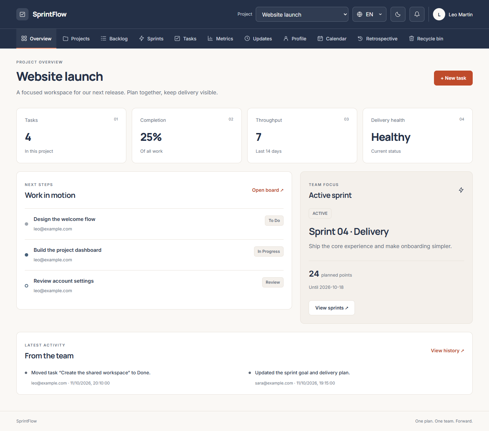
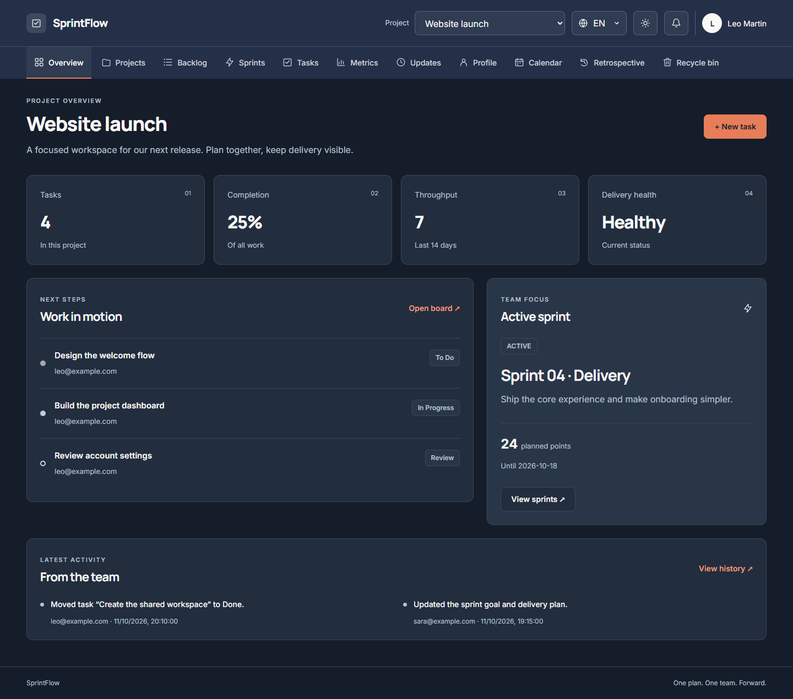
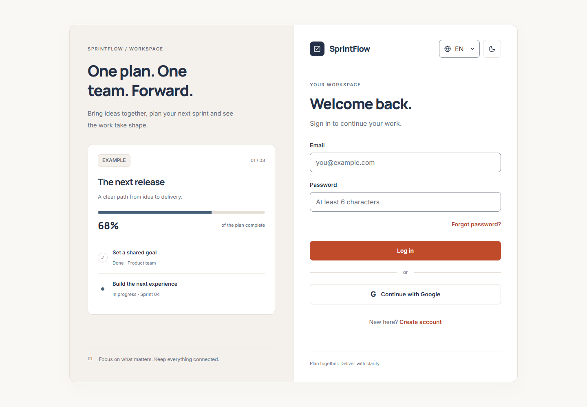
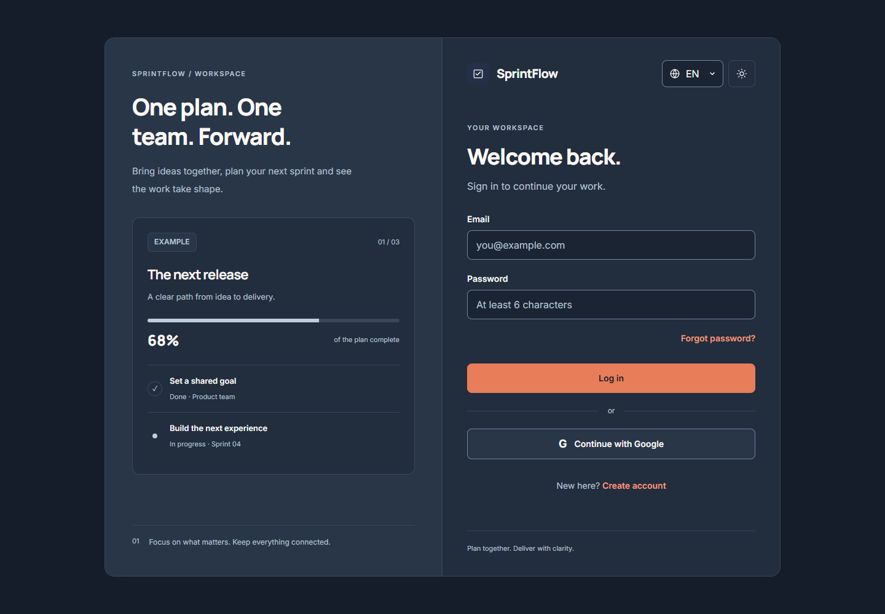

# SprintFlow Insight

   

SprintFlow helps teams turn a shared backlog into visible delivery: agree on priorities, plan a sprint, collaborate on tasks, and review progress against the sprint goal. Completed sprint history remains meaningful after tasks move into later sprints.

[Swedish start guide](docs/getting-started.sv.md) · [Feature guide](docs/workspace-features.md) · [API reference](docs/openapi.yaml)

## Preview

| Light mode | Dark mode |
| --- | --- |
|  |  |
|  |  |

## Features

- Projects, membership, Scrum/Kanban templates, archives, and a recoverable trash view.
- Prioritized stories, sprint planning, task boards, labels, checklists, comments, and attachments.
- Notifications, calendar, saved filters, onboarding, and sprint retrospectives.
- Burndown, delivery risk, completed sprint history, and shareable progress reports.
- Editable activity timeline, profile and security settings, English/Swedish, and light/dark themes.
- Contextual examples and expandable explanations on all eleven workspace pages, in English and Swedish. Examples guide entry without becoming saved values.
- Email/password accounts, optional Google sign-in, and optional password recovery through Gmail SMTP.

See [workspace features](docs/workspace-features.md) and [metric definitions](docs/metrics-definition.md) for behavior and limitations.

## Technology

| Layer | Implementation |
| --- | --- |
| Frontend | React, TypeScript, Vite; Node 24 builds the static application |
| Backend | Java 25, Spring Boot, REST |
| Authentication | Spring Security, BCrypt password hashing, server-managed sessions and CSRF protection |
| Database | PostgreSQL 16 with Flyway migrations |
| Local deployment | Docker multi-stage build and Docker Compose |
| Checks | Frontend tests, Maven tests/package checks, container checks in GitHub Actions |

Spring Boot serves the frontend and API from one address. Docker is a deployment tool; GitHub's language chart measures source files and does not list every tool used.

## Quick start — Windows

Install Git and Docker Desktop with Linux containers. This repository is private: sign in to GitHub with an account that has repository access when cloning. Then open PowerShell:

```powershell
git clone https://github.com/Mouaz7/sprintflow-insight.git
cd sprintflow-insight
.\start.cmd
```

Open **http://localhost:8081** when the script reports readiness. The first build downloads images and dependencies and can take several minutes. Later builds reuse cached layers. Java and Node are not required on your computer for this mode.

The script creates a private `.env` with a random database password on first run. Keep it: changing this password does not change an existing PostgreSQL user's password. Existing `.env` settings are preserved.

## Quick start — WSL/Linux/macOS

```sh
git clone https://github.com/Mouaz7/sprintflow-insight.git
cd sprintflow-insight
bash start.sh
```

Install Docker Desktop on macOS/Windows, or Docker Engine with the Compose plugin on Linux. The script creates `.env` with a random database password and prepares the upload directory automatically. On macOS it starts Docker Desktop; on Linux it starts the Docker service when run as root. In WSL, it uses the Windows launcher when Docker is unavailable, provided Windows interop is enabled. The first build requires internet access and may take several minutes. Open http://localhost:8081 when startup completes.

## First account

Choose **Create account** on the sign-in page. Register your own email/password, then create a project or choose a template. There is no default administrator password. Google/Gmail configuration is optional: ordinary registration and sign-in work with those values empty.

## Working in a project

Select a project in the header or the current-project control to view its backlog,
board, calendar and metrics. New story, sprint and task forms also have a project
selector: it determines where the new item is saved, while preserving draft text
and clearing relationships from the previous project. Changing the displayed
project never moves saved work between projects.

A task linked to a story inherits that story's sprint, including an unplanned
product backlog. Move the story to move all its linked tasks together. Standalone
tasks can choose a sprint independently. In Backlog, choose **Manual order** and use the
up/down buttons to save your own order; the sprint filter shows a sprint backlog or
unplanned stories. On Tasks, **Export filtered tasks** downloads CSV/PDF using the
current board filters and records those filters in the file.

See the [feature guide](docs/workspace-features.md) for every workspace feature
and the [metric definitions](docs/metrics-definition.md) for how delivery data is calculated.

## Configuration

All private settings belong in local `.env`, which is excluded from Git and Docker's build context.

| Variable | Purpose |
| --- | --- |
| `SPRINTFLOW_DB_PASSWORD` | Local PostgreSQL password; required |
| `SPRINTFLOW_ENCRYPTION_KEY` | AES-256-GCM key (Base64 of 32 random bytes) for secrets at rest; required, generated by the start scripts. Back it up with `.env` |
| `SPRINTFLOW_ENCRYPTION_PREVIOUS_KEYS` | Retired keys, comma separated, only while rotating keys ([ADR 0011](docs/adr/0011-encryption-and-key-rotation.md)) |
| `SPRINTFLOW_DB_URL`, `SPRINTFLOW_DB_USER` | Native database connection; Compose uses its internal PostgreSQL service |
| `SPRINTFLOW_PUBLIC_URL` | Browser address used in reset links; default `http://localhost:8081` |
| `SPRINTFLOW_COOKIE_SECURE` | `true` by default; the local start scripts write `false` for http://localhost |
| `SPRINTFLOW_GOOGLE_CLIENT_ID` | Optional OAuth Web client ID ending in `.apps.googleusercontent.com` |
| `SPRINTFLOW_SMTP_USERNAME`, `SPRINTFLOW_SMTP_PASSWORD` | Optional Gmail sender address and 16-character app password |
| `SPRINTFLOW_SMTP_HOST`, `SPRINTFLOW_SMTP_PORT` | SMTP server, default `smtp.gmail.com:587` with STARTTLS |
| `SPRINTFLOW_CONTAINER_UID`, `SPRINTFLOW_CONTAINER_GID` | Linux upload directory ownership; default `1000:1000` |
| `SPRINTFLOW_DB_POOL_SIZE` | Database connection pool size, default `10`; keep it well above the four concurrent event listeners |
| `SPRINTFLOW_EVENTS_MAX_RETRY_AGE` | How long failed event deliveries are retried before they are logged and dropped, default `PT24H` |
| `SPRINTFLOW_APP_PORT`, `SPRINTFLOW_DB_PORT` | Optional localhost host ports, default `8081` and `5432`; update `SPRINTFLOW_PUBLIC_URL` when changing the app port |

Run `.\configure-account-services.ps1` to enter Gmail credentials without showing the password. For Google sign-in, authorize `http://localhost:8081` as a JavaScript origin and add your account as a test user while the Google app is in testing. This integration verifies Google ID tokens on the server and does not require storing a client secret. See [account services](docs/account-services.md).

## Stop, restart, and data

```powershell
docker compose stop                    # Stop; keep data
docker compose up -d --wait             # Start existing containers
.\start.cmd                            # Rebuild and start changed code
docker compose logs --tail 100 app      # Inspect startup errors
docker compose down                    # Remove containers; keep database volume
```

Database data lives in **`sprintflow-insight_sprintflow-postgres`**. Attachments live in **`backend/data`**, mounted into the app container. Both survive container replacement. Back up both before destructive maintenance. **Do not use `docker compose down -v` to stop the app:** it deletes database volumes.

After changing `.env`, run `.\start.cmd` to recreate the app with the new settings. A health response at `/actuator/health` reports readiness without configuration details. Both published ports bind only to this computer's localhost.

## Troubleshooting

| Problem | Action |
| --- | --- |
| Docker unavailable | Start Docker Desktop and select Linux containers |
| First build appears slow | Watch the download/build output; the initial dependency download takes time |
| Port already occupied | Stop the application using that port, or configure an alternative host port |
| Database authentication fails | Restore the original `.env` password; an existing volume keeps its original database credentials |
| Upload fails on Linux | Match container UID/GID to directory ownership and confirm `backend/data` is writable |
| Google button unavailable | Configure a valid Web client ID and the exact browser origin |
| Reset mail unavailable | Configure SMTP username/app password; inspect Profile account-service status |
| Old interface appears | Rebuild using `.\start.cmd`, then refresh the browser |

Do not paste `.env`, OAuth downloads, or app passwords into issues or logs.

## Development

Install **Node 24** and a **Java 25 JDK**. On Windows:

```powershell
.\start.cmd -Native
```

This builds the frontend, starts only the database container, imports `.env`, and runs Spring Boot on Windows. It stops this project's Docker app before starting native mode. Switching back to Docker stops only a verified native SprintFlow instance from this workspace. Keep the native terminal open; Ctrl+C stops the native app. Existing WSL PostgreSQL remains a fallback when Docker is unavailable.

For frontend hot reload, run `npm ci` then `npm run dev` inside `frontend` while the backend is running. The Vite proxy forwards API requests to the backend. See [frontend guide](frontend/README.md) and [backend guide](backend/README.md).

## Tests

```powershell
npm ci --prefix frontend
npm run check --prefix frontend
cd backend
.\mvnw.cmd clean verify
cd ..
docker compose build app
```

`npm run check` runs frontend lint, formatting and type checks, tests, the production build and bundle size limits. TypeScript checks in both frontend and tooling reject unused local declarations and parameters. Maven verifies backend tests and packages the frontend already built in `frontend/dist`. With Java 25 and Docker running, Testcontainers creates isolated PostgreSQL 16 databases automatically; no external test database or credentials are needed. Normal verification includes jqwik properties, Toxiproxy fault tests and JaCoCo coverage checks. See the [testing guide](docs/testing.md) for PIT mutation testing, reports and thresholds. Existing databases need the one-time [V8 upgrade procedure](docs/adr/0005-postgresql-tests-and-sql-migrations.md) before this release starts.

All verification scripts are TypeScript and run directly with Node 24. Install tooling with `npm ci --prefix scripts`, then use:

```sh
npm run check --prefix frontend
npm run check --prefix scripts
npm run repository --prefix scripts
# Point real-database checks at a disposable test app:
npm run business-rules --prefix scripts
npm run creation-visibility --prefix scripts
# Layout-only checks use simulated API responses:
npm run responsive --prefix scripts
npm run guidance --prefix scripts
```

Browser checks use Playwright Chromium (`npx playwright install chromium` in `scripts/`) or an installed browser selected with `PLAYWRIGHT_EXECUTABLE_PATH`. `SPRINTFLOW_QA_URL` selects the app URL. Real-database checks create disposable accounts/projects and remove only their own data. Python is not required.

## CI

GitHub Actions checks pull requests and `main`: Node 24 frontend tests/build, Java 25 backend verification, packaged frontend presence, and a Docker build with an isolated container smoke check. The build artifact is retained for seven days. GitHub publication updates source code; it does not deploy a separate hosted service.

## Project structure

```text
.github/workflows/       CI
backend/                 Spring Boot API, security, services, Flyway, tests
frontend/                React/TypeScript application and tests
docs/                    Architecture, API, schema and user guides
scripts/                 Account configuration and native startup helpers
scripts/verification/    Browser and container verification
Dockerfile               Frontend/backend build and non-root Java runtime
compose.yaml             App + PostgreSQL, health checks, persistent storage
start.cmd / start.ps1    Windows entry points
start.sh                 Linux/macOS entry point
.env.example             Public configuration template (no credentials)
```

Further reading: [architecture](docs/architecture.md), [schema](docs/data-schema.md), [definition of done](docs/definition-of-done.md).

## Security hardening

Task lists require `projectId` and retain their array response. Task, story, sprint and project
edits require `If-Match: "VERSION"`; missing versions return 428 and stale versions 412.
Task/story/sprint deletion moves work to the recycle bin; only the project owner may purge it.
