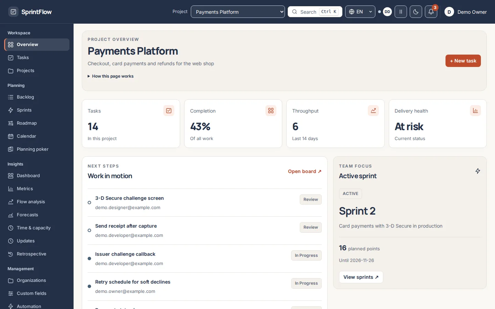
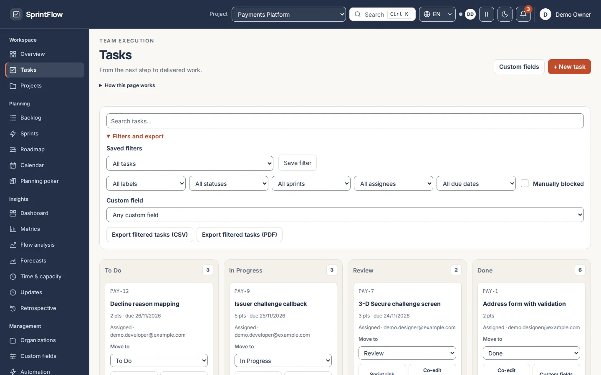
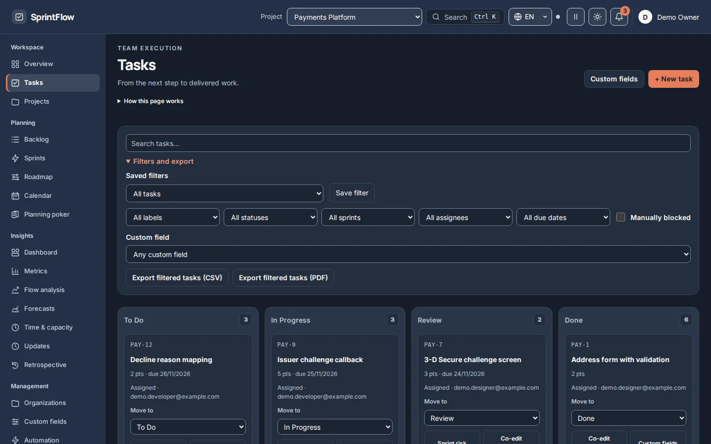
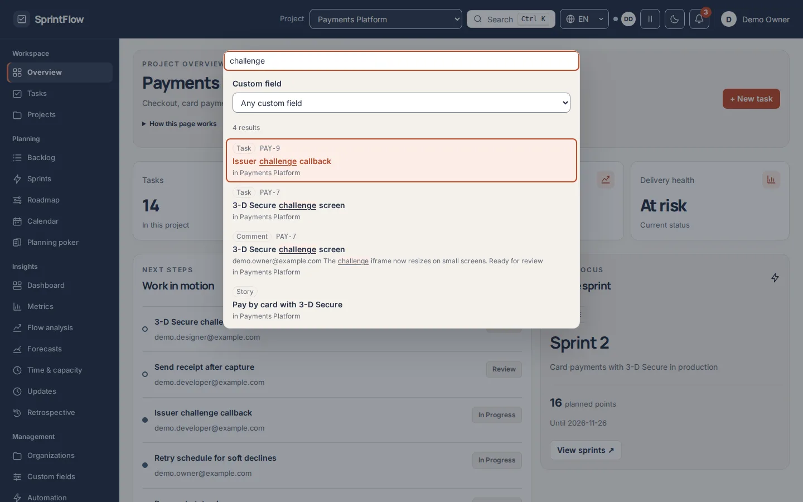

# SprintFlow Insight

[](https://github.com/Mouaz7/sprintflow-insight/actions/workflows/quality.yml)   

Plan a sprint, collaborate on a shared board and review what the team delivered. SprintFlow combines a prioritized backlog with live task updates, planning poker, time tracking and delivery analytics. The interface supports English and Swedish, light and dark themes, keyboard navigation and mobile screens.

[Start in Swedish](docs/getting-started.sv.md) · [Feature guide](docs/workspace-features.md) · [API contract](docs/openapi.yaml) · [Roadmap](https://github.com/Mouaz7/sprintflow-insight/issues/38)

## See the app

These screenshots come from the packaged application and PostgreSQL using fictional demo accounts. [Regenerate them](docs/testing.md#readme-screenshots-d1) after a major interface change.

| Project overview | Live task board |
| --- | --- |
|  |  |
|  |  |

<details>
<summary>Planning, collaboration, analytics and mobile screenshots</summary>

| View | Screenshot |
| --- | --- |
| Backlog | [Prioritized stories](docs/images/screenshots/backlog.webp) |
| Sprints | [Sprint planning and history](docs/images/screenshots/sprints.webp) |
| Roadmap | [Epics and planned dates](docs/images/screenshots/roadmap.webp) |
| Planning poker | [Revealed votes and disagreement](docs/images/screenshots/poker.webp) |
| Time and capacity | [Logged time and estimates](docs/images/screenshots/time.webp) |
| Custom fields | [Typed project fields](docs/images/screenshots/custom-fields.webp) |
| Comments | [Live discussion and an @mention](docs/images/screenshots/task-comments.webp) |
| Dashboard | [Personal project widgets](docs/images/screenshots/dashboard.webp) |
| Flow | [Cumulative flow, WIP and cycle times](docs/images/screenshots/flow.webp) |
| Forecasts | [Delivery probabilities and assumptions](docs/images/screenshots/forecast.webp) |
| Metrics | [Sprint progress](docs/images/screenshots/metrics.webp), [dark mode](docs/images/screenshots/metrics-dark.webp) |
| Calendar and retrospective | [Calendar](docs/images/screenshots/calendar.webp), [team retrospective](docs/images/screenshots/retrospective.webp) |
| Import and audit | [CSV/Jira import and audit](docs/images/screenshots/import-audit.webp) |
| Activity and profile | [Activity](docs/images/screenshots/activity.webp), [profile](docs/images/screenshots/profile.webp), [email preferences](docs/images/screenshots/email-preferences.webp) |
| Shared report and account | [Public report snapshot](docs/images/screenshots/shared-report.webp), [sign-in](docs/images/screenshots/sign-in.webp) |
| Mobile | [Overview](docs/images/screenshots/mobile-overview.webp), [board](docs/images/screenshots/mobile-board.webp) |

The generator also captures Projects and Trash. All images and their SHA-256 hashes are listed in [the capture manifest](docs/images/screenshots/manifest.json).

</details>

## What works

| Area | Behavior |
| --- | --- |
| Project workspace | Scrum/Kanban templates, Owner/Admin/Member/Viewer access, membership, archives and recoverable trash |
| Planning | Ordered backlog, sprint goals/history, epics, roadmap dependencies, PERT estimates and planning poker with private votes |
| Data portability | CSV/Jira mapping and dry-run, [Apache research subset converter](docs/import-export.md), account JSON ZIP and retained admin audit |
| Task delivery | Board, labels, checklists, attachments, saved filters, typed custom fields and filtered CSV/PDF exports |
| Collaboration | Live updates and presence, comments, @mentions, in-app notifications and optional daily/weekly email summaries |
| Time | Manual entries, one running timer per account, estimates versus actuals, sprint availability and capacity warnings |
| Insights | Burndown, cumulative flow, cycle-time/WIP views, bootstrap delivery forecasts, personal dashboards and shared report snapshots |
| Navigation | Reloadable routes, project-scoped search and command palette, keyboard shortcuts and EN/SV help |
| Accounts | Email/password, optional Google sign-in, optional password recovery, profile and notification preferences |

Forecasts depend on the recorded history and assumptions; warnings and accessible data tables accompany the charts. See [metric definitions](docs/metrics-definition.md). Email summaries start **Off**, require SMTP for delivery and have a confirmation page for unsubscribing.

## Architecture

```text
Browser → React / TypeScript / Vite
                    ↓ same-origin REST + WebSocket
          Java 25 / Spring Boot / Spring Modulith
                    ↓
          PostgreSQL 16 + Flyway migrations
          Local attachment files
```

Spring Boot serves the built frontend and API from one address. Feature folders and lazy routes organize the frontend; backend modules use durable domain events for notifications and realtime invalidations. PostgreSQL stores sessions and application data. [Architecture](docs/architecture.md), [module diagrams](docs/architecture/all-docs.adoc) and [ADRs](docs/adr/README.md) describe the boundaries and decisions.

## Run with Docker

Install Git and Docker with the Compose plugin. On Windows/macOS, start Docker Desktop with Linux containers.

```sh
git clone https://github.com/Mouaz7/sprintflow-insight.git
cd sprintflow-insight
bash start.sh                          # Linux / macOS / WSL
```

On Windows, use PowerShell and run `.\start.cmd` instead. Open **http://localhost:8081** after startup reports readiness. Java and Node are only needed for native development; Docker builds them inside the image. The first build needs internet access for dependencies.

The launchers prepare a private `.env`, generating the database password and encryption key once. Keep this file with your backups: replacing its password does not change an existing database user's password, and losing its encryption key makes encrypted values unreadable.

Choose **Create account**, register an email/password and create a project or start from a template. There is no default administrator account. Google and SMTP settings can stay empty.

## Native development

Use a **Java 25 JDK**, **Node 24** and Docker for PostgreSQL. On Windows:

```powershell
.\start.cmd -Native
```

The launcher builds the frontend, imports `.env`, starts the database and runs Spring Boot. On Linux/macOS the equivalent manual sequence is:

```sh
bash scripts/env-bootstrap.sh
docker compose up -d --wait postgres
set -a
. ./.env
set +a
npm ci --prefix frontend
npm run build --prefix frontend
cd backend
./mvnw spring-boot:run
```

These manual commands use the default database/app ports from `.env.example`. If you change host ports, also set `SPRINTFLOW_DB_URL`, `SPRINTFLOW_PUBLIC_URL` and `PORT` for the native process. Maven alone does not read `.env`.

For frontend hot reload, keep the backend running, then run `npm run dev --prefix frontend`. Vite serves port 5173 and proxies API/WebSocket traffic to localhost:8081. See the [frontend guide](frontend/README.md) and [backend guide](backend/README.md).

## Configuration and data

Private settings belong in `.env`, which Git and Docker's build context exclude. Use [.env.example](.env.example) as the complete public template.

| Setting | Purpose |
| --- | --- |
| `SPRINTFLOW_DB_PASSWORD` | Required database password; generated by the launchers |
| `SPRINTFLOW_ENCRYPTION_KEY` | Required Base64 key of 32 random bytes; generated once |
| `SPRINTFLOW_ENCRYPTION_PREVIOUS_KEYS` | Readable retired keys during [two-stage key rotation](docs/adr/0015-encryption-and-key-rotation.md) |
| `SPRINTFLOW_DB_URL`, `SPRINTFLOW_DB_USER` | Native database connection; Compose uses its internal service |
| `SPRINTFLOW_APP_PORT`, `SPRINTFLOW_DB_PORT` | Local published ports, default 8081 and 5432 |
| `SPRINTFLOW_PUBLIC_URL` | Browser address for reset and email links; update when changing the app URL |
| `SPRINTFLOW_COOKIE_SECURE` | Secure cookies by default; launchers set false for local HTTP |
| `SPRINTFLOW_GOOGLE_CLIENT_ID` | Optional Google OAuth Web client ID; no client secret is stored |
| `SPRINTFLOW_SMTP_HOST`, `SPRINTFLOW_SMTP_PORT` | SMTP server, default Gmail port 587 with required STARTTLS |
| `SPRINTFLOW_SMTP_USERNAME`, `SPRINTFLOW_SMTP_PASSWORD` | Optional sender and app password for recovery and email summaries |
| `SPRINTFLOW_CONTAINER_UID`, `SPRINTFLOW_CONTAINER_GID` | Upload directory ownership, default 1000:1000 |

See [account services](docs/account-services.md) for Gmail/Google setup, `.\configure-account-services.ps1` for private Windows entry, and the [schema](docs/data-schema.md) for persisted data. Compose binds both published ports to localhost. Production HTTPS must use secure cookies and the correct public URL.

```sh
docker compose stop                   # Stop; keep data
docker compose up -d --wait            # Start existing containers
bash start.sh                         # Rebuild changed code
docker compose logs --tail 100 app     # Diagnose startup
docker compose down                   # Remove containers; keep the volume
```

The database uses the `sprintflow-insight_sprintflow-postgres` volume; uploads use `backend/data`. Back up both plus the encryption keys. `docker compose down -v` deletes database volumes and is not a normal stop command. Existing releases using the old Java V8 migration need the documented [one-time Flyway upgrade procedure](docs/adr/0005-postgresql-tests-and-sql-migrations.md).

If startup fails, check Docker availability, free ports and the original `.env` database password. Upload errors on Linux usually need matching directory ownership. [Health](http://localhost:8081/actuator/health) reports readiness without exposing configuration.

## Tests and quality gates

Build the frontend before Maven so the server package includes the UI:

```sh
npm ci --prefix frontend
npm run check --prefix frontend
cd backend
./mvnw clean verify
cd ..
npm ci --prefix scripts
npm run check --prefix scripts
npm run repository --prefix scripts
```

With Java 25 and Docker running, Testcontainers creates disposable PostgreSQL databases. Tests do not use `.env` or a developer database. Verification includes endpoint/role contracts, jqwik properties, Toxiproxy faults and JaCoCo coverage floors. Use `mvnw.cmd` on Windows. [Testing](docs/testing.md) documents the coverage and bounded PIT mutation gates and reports.

Run browser tests against a disposable running app/database:

```sh
npm ci --prefix frontend/e2e
cd frontend/e2e
npx playwright install chromium
E2E_BASE_URL=http://127.0.0.1:8081 npm test
```

The real-database suite covers account, role, planning, collaboration, custom-field, analytics, time, dashboard, import/export and email-preference flows; axe rejects serious/critical accessibility findings. Fixture-based [responsive, guidance and Trusted Types checks](docs/testing.md) provide additional UI evidence. The screenshot generator is documented [here](docs/testing.md#readme-screenshots-d1).

GitHub Actions runs frontend/repository checks, a Maven `verify`, Docker startup/restart checks, secret/dependency scans, PIT, Playwright/axe, Storybook, Trivy, ZAP, k6 and Lighthouse. CodeQL and Scorecard have separate workflows. Actions and base images are pinned. On `main`, a passing pipeline publishes the tested image to `ghcr.io/mouaz7/sprintflow-insight` with cosign signing, SLSA provenance and an SBOM attestation. See [supply chain](docs/security/supply-chain.md).

## Status and documentation

[Roadmap #38](https://github.com/Mouaz7/sprintflow-insight/issues/38) and [open issues](https://github.com/Mouaz7/sprintflow-insight/issues) track delivery. Organizations/teams, TOTP, automation rules, GitHub integration and public API/webhooks remain separate roadmap work; their presence in an issue or prototype does not mean they are available in the app.

| Document | Contents |
| --- | --- |
| [Getting started in Swedish](docs/getting-started.sv.md) | Local startup and first use |
| [Workspace guide](docs/workspace-features.md) | Features, permissions and conflict behavior |
| [Architecture](docs/architecture.md) / [ADRs](docs/adr/README.md) | Modules and design decisions |
| [Schema](docs/data-schema.md) / [OpenAPI](docs/openapi.yaml) | Data and HTTP contracts |
| [Metric definitions](docs/metrics-definition.md) | Calculations, assumptions and limits |
| [Testing](docs/testing.md) | Commands, reports, browser checks and screenshots |
| [Collaborative text](docs/collaboration.md) | Task descriptions, retrospective notes and STOMP protocol |
| [Security review](docs/security-review.md) / [ASVS](docs/security/asvs.md) | Security boundaries and verification |
| [Definition of Done](docs/definition-of-done.md) | Completion criteria |

Source: `backend/` (API/modules/migrations), `frontend/` (app), `frontend/e2e/` (browser tests), `scripts/verification/` (tooling), `.github/workflows/` (CI), and `docs/` (guides and evidence).
