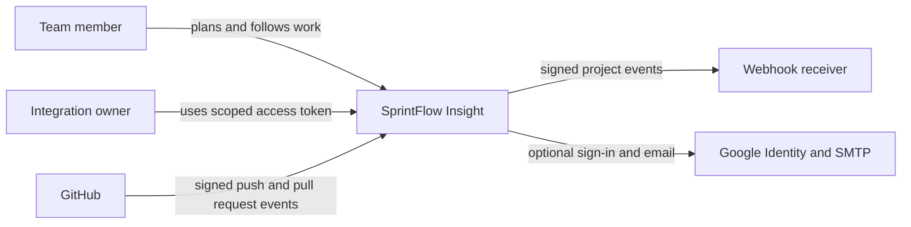
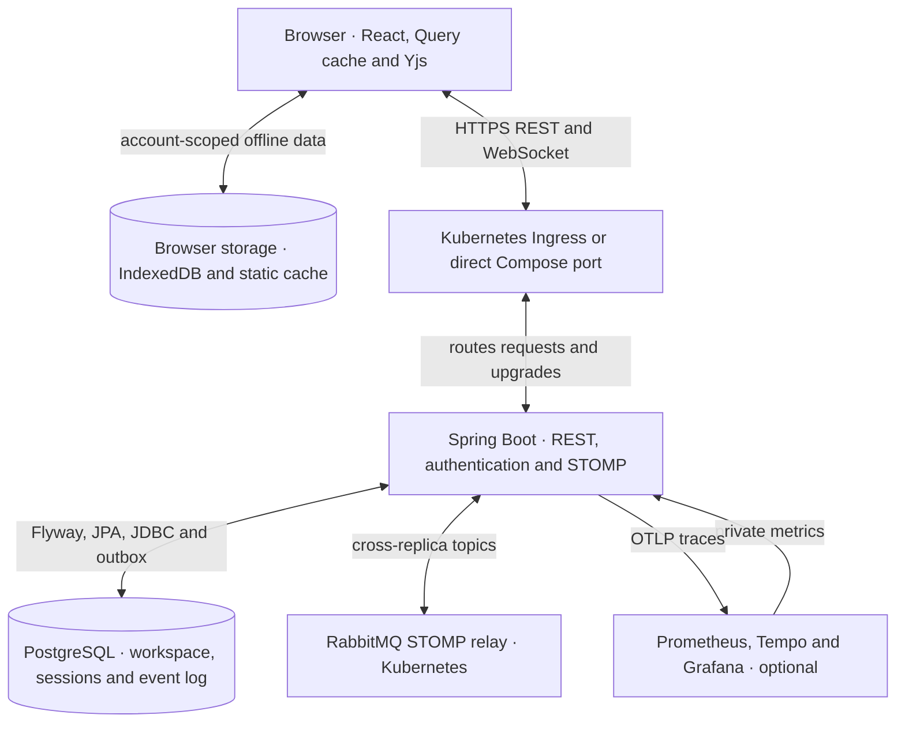

# Architecture

SprintFlow keeps the browser client and REST API separate during development and packages them together for production.

```text
frontend/   React + TypeScript + Vite
backend/    Java 25 + Spring Boot + REST API
Dockerfile  Node 24 + Maven/Java 25 build, non-root Java runtime
compose.yaml App + PostgreSQL 16, persistent volume and uploads
```

```text
React + TypeScript (Vite, port 5173)
        │ /api proxy in development
        ▼
Spring Boot REST API (port 8081)
        │ Spring Security session + CSRF
        ▼
PostgreSQL + Flyway migrations
```

## C4 system context



## C4 containers



Compose runs one application container with PostgreSQL and the in-process STOMP broker. Helm adds multiple app replicas and RabbitMQ. Spring Security uses the same session and project authorization in both deployment modes.

## Boundaries

- The frontend is split into `app/` (shell, routes and composition), `features/{auth,tasks,planning,insights,projects,profile,onboarding,search}`, `shared/{ui,i18n,lib,theme}` and `api/`. Features may import only themselves, `shared` and `api`; ESLint enforces this ([ADR 0008](adr/0008-frontend-feature-folders-and-lint.md)). Test helpers in `src/test` may be imported by tests only.
- `frontend/src/api` is the frontend boundary for REST requests. It sends the server-issued CSRF token on every state-changing request and always uses same-origin credentials. The Google sign-in component also loads the official Identity Services script.
- The Java API has feature packages for authentication, projects, stories, tasks, metrics, collaboration, notifications and search.
- Spring Security protects `/api/**` except narrowly scoped sign-in, registration, recovery, CSRF and expiring public-report reads.
- Sessions are stored in PostgreSQL (Spring Session JDBC) and identify the account by immutable user ID. Profile changes lock that account and move email-based project, assignment, notification and author references together in one transaction. Changing or resetting a password signs the account out of its other sessions ([ADR 0002](adr/0002-sessions-in-postgresql.md)).
- Token-bucket rate limits ([ADR 0003](adr/0003-token-bucket-rate-limiting.md)): credential routes per client address (30 login/Google/token-confirmation attempts, 20 registrations and 10 recovery requests per minute) and all other API writes per account (300 per minute, uploads 30). Rejections return a 429 problem with `Retry-After`. Forwarded IP headers are not trusted.
- `ProjectAccessService` loads an `AccessContext` (project state and the caller's role) with one query per request and checks a declared need: read, write, manage, or owner, each with or without archive protection ([ADR 0004](adr/0004-single-query-access-context.md)). Admins manage members and viewers; only the owner manages admins.
- Every error is an RFC 9457 problem document with a stable `code` and `type` from the `ErrorCode` catalogue ([ADR 0001](adr/0001-problem-details-error-catalogue.md)). Request bodies are explicit records, never JPA entities.
- PostgreSQL 16 is used in production and tests. Testcontainers supplies the disposable database through shared `JdbcConnectionDetails`. V8 is PostgreSQL SQL with a partial unique index. Older installations that ran the Java V8 migration need the documented Flyway history repair. [ADR 0005](adr/0005-postgresql-tests-and-sql-migrations.md).
- Connection failures in controllers or the JDBC session filter return a generic 503 problem with `Retry-After: 5` while the response is still buffered. Health reports DOWN during an outage; restoring connectivity lets the connection pool and existing sessions recover without restarting the app.
- Project and notification visibility is filtered in database queries. Both list endpoints accept optional `page` and `size` parameters; existing clients can omit `page` to receive the complete accessible list. Due-date reminders query eligible tasks in batches of 200 and load project memberships in batches.

## Browser interface

`App` provides the query client, `LanguageProvider`, `ThemeProvider` and React Router ([ADR 0013](adr/0013-router-query-and-typed-lexicon.md)). Each workspace view has its own route (`/overview`, `/projects`, `/backlog`, `/sprints`, `/tasks`, `/metrics`, `/updates`, `/profile`, `/calendar`, `/retrospective`, `/trash`) and is a lazily loaded chunk. `/report/:token` shows an anonymous report without a session request, and `/reset-password?token=…` opens the new-password form; links from before A6 (`/?report=`, `/?resetToken=`) redirect there. Spring forwards these paths to the nonce-transformed `index.html` (`CspResources`), so reloads and shared links get the same CSP.

`SessionGate` loads the account and its projects through TanStack Query and shows `AuthScreen` (sign-in, registration, reset requests and reset links) to signed-out visitors. The workspace layout owns the one `<main>`, the skip link, top and mobile navigation (links with `aria-current`), the single project picker, notifications and server preference sync; after a route change focus moves to the page heading. Dedicated pages render the dashboard, projects, backlog, sprints, tasks, metrics, activity timeline, profile, calendar, retrospectives and recycle bin. Shared components provide discussions, checklists, labels, saved filters, notifications, onboarding and report sharing.

Data is read through query hooks (`src/api/queries.ts` and `features/<name>/queries.ts`); components mounting together share one request, and writes refresh their own keys and mark the rest of the project stale. Text comes from typed `en`/`sv` lexicons (`features/<name>/i18n.ts`, read with `useT`), with plural and date formatting on `Intl`. `src/boot.ts`, loaded by `index.html` with the CSP nonce, applies the remembered language and theme before React renders. Board columns and the backlog switch to TanStack Virtual above 60 items.

`ui.tsx` provides page headings, feedback, side panels and confirmation dialogs. The dialog focus helper traps keyboard navigation, disables background interaction and restores focus. Dirty editors request confirmation before closing. Styling enters through the short `styles.css` import manifest, with shared tokens/base/controls, feature CSS and a final accessibility layer. Breakpoints are centralized in `shared/styles/breakpoints.css`; fonts are self-hosted. Shared SVG charts expose data tables and native keyboard exploration. The separate Storybook catalogue has light/dark Playwright baselines; see ADR 0018.

The original redesign reused the existing REST routes and schema. The subsequent collaboration features add lifecycle, preference, template, retrospective and report routes, with migration V6 for durable storage. Normal UI deletion uses soft-delete timestamps; permanent purge remains a separate owner-only transaction. Report links store hashed tokens and aggregate snapshots. Account preferences are saved on the server; the browser also caches appearance and project selection.

## Local verification

The backend test suite covers session-protected API flows, roles, attachments, project-scoped metrics and CSRF/security headers. The React test suite covers UI flows, routing, CSRF use in the REST client through MSW, axe accessibility checks and the 5,000-item virtualization budget. CI packages the React client in the Spring Boot JAR, tests the container, and publishes signed images from the passing main pipeline. The Kubernetes job tests a rolling upgrade and removal of the pod holding an active WebSocket.

Run `./mvnw clean verify` in `backend` with Java 25 and Docker running. Testcontainers creates and removes its own PostgreSQL databases; no external test URL or database credentials are needed. CI runs the same suite, enforces JaCoCo coverage and runs PIT against selected logic classes in a separate job. See [backend testing](testing.md) for reports, thresholds, migration fixtures and fault injection.

## A3 application modules and events

Backend feature packages now live in `auth`, `workspace/{project,story,task,sprint,activity,collaboration,attachment,lifecycle}`, `reporting` and `notifications`. Controllers delegate to constructor-injected application services. `ApplicationModules.verify()` rejects module cycles and undeclared/internal dependencies; the same architecture suite rejects repository access from controllers and field injection.

The generated [C4 component diagram](architecture/components.puml) and [module documentation](architecture/all-docs.adoc) are regenerated by `ModuleArchitectureTest`. [ADR 0006](adr/0006-modulith-and-transactional-events.md) explains the module boundaries, their initial read interfaces, and why workspace features currently share one transactional module.

Task movement and comments publish typed events in their transaction. Listeners run after commit through the JDBC event registry. Successful records are deleted. The retry scheduler claims outstanding records older than a minute with `FOR UPDATE SKIP LOCKED` and a lease so replicas can share the queue. Notification deduplication uses the event and recipient. After `app.events.max-retry-age` (default 24 hours), maintenance logs the publication type and ID and removes the record.

## A4 runtime

The backend runs on Java 25 and the Spring Boot 4.1 line (Spring/Security 7, Jackson 3, Hibernate 7, Flyway 11). Virtual threads handle servlet requests and asynchronous module listeners. At most four listeners run at once (`spring.task.execution.simple.concurrency-limit`, restored by B1's named executor with a 1,000-task queue), well below the 10-connection pool (`SPRINTFLOW_DB_POOL_SIZE`), so an event burst cannot starve HTTP requests of connections. Outbound Google signing-key requests pass through the bounded application `RestClient`; token verification stays in Google's library. The V14 JDBC event registry remains compatible through Modulith's legacy-structure setting. See [ADR 0007](adr/0007-boot4-java25.md) for BOM ownership, upgrade safety, timeouts and performance measurements.

## B9 search

The `search` module serves `GET /api/search` with PostgreSQL full-text search: generated Swedish/English `tsvector` columns with GIN indexes on tasks, stories, sprints, comments and projects (V16), plus epics (V18, using B3’s shared V17 storage prerequisite), and `pg_trgm` trigram similarity on titles for typos. One SQL statement filters by membership, matches, ranks (`ts_rank` + trigram similarity), pages by keyset and highlights; an exact task key (`SF-123`) ranks first. Highlights are returned as plain-text segments. The frontend's `features/search` adds the Ctrl/⌘+K command palette and a keyboard-shortcut help dialog. See [ADR 0016](adr/0016-postgresql-full-text-search.md).

## B1 realtime

The `realtime` module consumes durable workspace events after commit, writes a deduplicated per-project replay log (V19), and broadcasts identifiers over authenticated STOMP. Each subscription and replay request checks project access. Shared-text destinations also check editing access for mutations. The frontend reloads affected queries and fills gaps using its last applied sequence. Kubernetes shares presence leases in PostgreSQL and relays STOMP through RabbitMQ. [Realtime protocol](adr/0017-realtime-stomp-and-sequence-numbers.md) · [Collaborative text](collaboration.md) · [Cluster recovery](adr/0040-kubernetes-and-cluster-recovery.md).

## Public integrations and offline writes

Scoped access tokens address the versioned `/api/v1` API. Signed GitHub events link changes to tasks by project and task key. Project webhooks are queued with transactional state and retries. The browser persists a bounded set of queries and supported offline commands in IndexedDB. Replayed commands use the task version and commit an idempotent receipt in the same transaction. [Public API and webhooks](adr/0038-public-api-and-outbound-webhooks.md) · [Offline workspace](adr/0041-offline-workspace.md).
