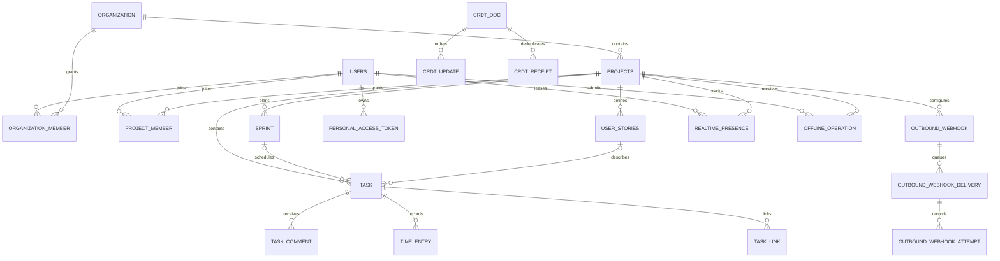

# Data schema reference

PostgreSQL is the system of record. The authoritative, executable schema is the ordered Flyway migration set in `backend/src/main/resources/db/migration`; do not edit a deployed schema manually. The migration integration test applies all migrations to a clean PostgreSQL-compatible test database and starts Hibernate in `validate` mode.

## Logical relationships



The diagram shows the main workspace, collaboration and integration relationships. The migration set defines all physical foreign keys, deletion rules and composite project constraints.

- `users` stores normalized unique email addresses, BCrypt password hashes, profile fields, and hashed recovery codes.
- `projects` has one owner email and a unique `key` (2–10 upper-case letters, check constraint `projects_key_format`, unique `projects_key_unique`) that prefixes task identifiers such as `SF-123`.
- `project_member` stores project membership and the supported roles `Owner`, `Admin`, `Member`, and `Viewer`. Since V15 every row references its account through `user_id` (`users.id`, `ON DELETE CASCADE`, unique per project). Access checks match on `user_id` only; `email` is a display copy that follows the account's address. The owner always has an `Owner` row, which is what grants owner access.
- `sprint` belongs to a project and stores lifecycle state, planned points, schedule dates, and completion time.
- `user_stories` belongs to a project and can be assigned to one sprint in that same project. Story points are restricted to 1, 2, 3, 5, or 8; business value is optional and ranges from 1 to 5.
- `task` has a per-project `number` (unique with `project_id`, positive, never changed after creation). `project_task_counter(project_id, last_number)` holds the last number handed out; creation increments it with one `INSERT … ON CONFLICT DO UPDATE … RETURNING`, which locks the counter row, so concurrent creators never collide and numbers are never reused.
- `task` belongs to a project and can reference a same-project story and sprint and an assigned project member. Normal deletion preserves references in the recycle bin. Permanently purging a story clears its task references; permanently purging a task removes its associated comments and attachments.
- `task_status_history`, `activity_event`, `task_comment`, `task_attachment`, and `notification` are project-scoped supporting records. Status history stores actor and timestamp for workflow changes and state snapshots when points or sprint assignments change.
- `poker_session` estimates one story through a composite story/project foreign key; `poker_vote` identifies one user’s card per session and round. Only revealed rounds may leave the server, apart from the caller’s own card. One open session per story is enforced by a partial unique index. Story/project deletion cascades; account deletion removes its votes and nulls the facilitator. V23 adds these tables.
- V24 adds optional task estimates in minutes, `time_entry` with a composite task/project foreign key and one-running-timer index per user, and `sprint_capacity` with a composite sprint/project foreign key. Account deletion removes timers, anonymizes completed hours and clears capacity. Task/project deletion cascades through time entries.
- `password_reset_tokens` references its account and stores only a SHA-256 hash of the one-time token.
- Migration V6 adds archive/trash timestamps, JSON-encoded task labels/checklists, versioned comments, account preferences, sprint retrospective entries and shared report snapshots.
- `user_preferences` references its account with cascading removal. Saved filters are private to that account.
- `retrospective_entry` is project/sprint scoped. Account removal anonymizes its author; permanent project removal deletes the entries.
- `shared_report` stores a hash of the random link token and a limited snapshot with creation/expiry times. Account removal revokes links created by that account; project removal deletes all project reports.

Migration V15 backfills the B0 building blocks without changing row versions. Project keys are derived from names (initials of up to four words, otherwise the first four letters, accents folded, `PRJ` when fewer than two letters remain); collisions get the suffix A, B, …, Z, AA in project-id order. Existing tasks are numbered in id order per project, and counters start at each project's highest number. Membership rows get `user_id` by case-insensitive email match. Rows without an account are removed, case-variant duplicates collapse to the most privileged row, a missing owner row is added, and stale `Owner` rows of former owners become `Member`.

The email match in V15 is ambiguous only if `users` holds two accounts whose addresses differ in case alone. `users.email` is unique only case-sensitively, but the application has always stored addresses lower-cased, so such pairs can only come from manual edits or imports. A member row could then attach to either account. V15 has already been applied, so it is left unchanged, and no guard migration was added, for two reasons. First, a check running after V15 cannot prevent the assignment; it could only block startup afterwards. Second, a V18 applied before the reserved V16/V17 would make Flyway reject those later migrations (out-of-order is disabled). Before upgrading a database that may contain such data, run this query; it must return no rows:

```sql
select lower(email), count(*) from users group by lower(email) having count(*) > 1;
```

If it returns rows, merge or rename the duplicate accounts before applying V15.

Encrypted authenticator and webhook secrets use `EncryptionService` envelopes `sf1:<keyId>:<base64url(iv|ciphertext|tag)>` in text columns. The key ID selects the key used for decryption and rotation. [ADR 0015](adr/0015-encryption-and-key-rotation.md).

Migration V13 adds the Spring Session tables `spring_session` and `spring_session_attributes`. `principal_name` holds `user:<id>`, which lets the server find and revoke all of an account's sessions.

Migration V12 adds `user_stories.backlog_position` and a project/order index. Existing
stories keep their relative ID order; subsequent manual changes are atomic and versioned.
The backend owns the position field, and new stories append to their project's order.

## Isolation and lifecycle

Every project read and write checks membership in the service layer. PostgreSQL migrations keep indexes and schema changes reproducible. Normal UI deletion now moves work into the recycle bin; dedicated restore routes retain relationships and data. Archived projects remain readable but reject work changes. Trashed projects reject ordinary access. The owner-only DELETE project endpoint remains the permanent purge operation: it removes all project records in one transaction, including retrospective entries and reports. Uploaded attachment files are removed after commit, so a rollback preserves them. Other projects are unaffected. Account deletion is rejected while the account owns a project, including projects in the recycle bin; the owner must permanently remove the project or transfer ownership first. Account deletion removes account-linked tokens, comments, notifications, memberships and preferences, clears task assignees, anonymizes retrospective authors, revokes account-created reports and removes the account.

See [`architecture.md`](architecture.md) for the service boundaries and [`openapi.yaml`](openapi.yaml) for the REST surface.


B3 uses the V17 epic/story relation, task_dependency and task_estimate foundation delivered with B9. V20 adds task_estimate.version (initially 0) and active (initially true) for If-Match updates. Clearing an estimate retains an inactive revision marker, excluded from API reads and forecasts; replacement revisions increase instead of resetting. Permanent task deletion cascades to this marker. Cross-project relations are prevented by composite foreign keys; deleting an epic detaches its stories. Applied V17–V19 migrations are unchanged.

B5 adds V21: `history_project_time_idx` on `task_status_history(project_id,changed_at)`; `project_wip_limit(project_id,status,wip_limit)` and `project_wip_settings(project_id,version)`. Both new tables cascade on project deletion. The settings revision survives clearing limits and is checked using If-Match under the project row lock. Existing workflow history is not rewritten.

B18 (V25) adds `dashboard_layout`: an ordered JSONB array of up to six unique typed widgets and their wide-card flags, one row per `(project_id, user_id)`, with an optimistic version. The project/account foreign keys cascade on deletion; preferences are private and are never addressed by another user id in the API. Reading defaults inserts no row. See [ADR 0025](adr/0025-personal-project-dashboards.md).

B8 (V26) adds `comment_mention` with a composite comment/project foreign key and account/comment deletion cascades; `digest_subscription` with private account cadence, IANA zone, UTC due/checkpoint/sent instants, rotating opt-out nonce and optimistic version; and the standard `shedlock` table for the distributed email-summary scheduler. The due-time index supports bounded sweeps. See [ADR 0026](adr/0026-mentions-and-email-summaries.md).

## V22 — typed custom fields

`custom_field` belongs to a project and stores `name`, immutable `kind`, bounded JSONB `options` and an optimistic `version`. A unique `(project_id, lower(name))` index prevents duplicate names. `task_custom_value` has `(task_id, field_id)` identity and one typed value column: text, numeric(24,6), date or project membership id. Checks enforce exactly one column compatible with the saved kind, finite decimals and calendar dates in years 0001–9999. Composite foreign keys enforce matching task/definition/member projects. Membership and hard deletion cascade; soft deletion preserves values. Scope, number/date range and membership indexes support filtering and cleanup.

`task.custom_fields_revision` is an internal scalar used to increment the existing task version on a changed value snapshot. No custom-value collection is added to core task list queries. Task revision/value reads use a repeatable-read snapshot. CSV streams value rows ordered by task/field using a fetch size of 200 in the same repeatable-read transaction as definitions and tasks.

B19 (V27) adds `import_batch` with project/request-hash uniqueness and immutable replay receipts, `import_source` with scoped external-key uniqueness, composite task/project foreign keys and original text/date provenance, and independent `admin_audit_event`. Audit actor/project IDs deliberately do not cascade; a trigger blocks modification during 90-day retention. Bounded cleanup uses the shared ShedLock infrastructure. See [ADR 0027](adr/0027-imports-account-export-and-audit.md).

## V31 — collaborative text

`crdt_doc` belongs to exactly one task or retrospective entry in the same project. Composite foreign keys enforce that relationship and cascade on permanent deletion. The document carries an immutable seed, current revision, compressed snapshot revision and latest projected revision. `crdt_update` stores the ordered tail. `crdt_receipt` retains each update UUID and its SHA-256 hash after compaction to make reconnects idempotent. See [the collaboration protocol](collaboration.md).

## V32 — organizations and teams

`organization_member` links account IDs to organization roles. The migration assigns existing projects to the project owner's personal organization and reserves a legacy organization for unlinked historical data. The projects table enforces uniqueness on `(organization_id, name)`.

`team_member` references both its team and its organization membership using composite keys. `organization_invite` holds only a digest of its bearer secret and enforces a database expiry. `organization_template` holds the starter layout and its default description. The four scoped tables apply RLS using the transaction's organization ID. [Organization scope ADR](adr/0034-organization-scope.md).

## V33 — two-factor authentication

`account_mfa` stores the encrypted setup secret, enrollment timestamp, most recent accepted time step and failure-window state. `account_mfa_recovery` stores one digest per unused code. `account_mfa_challenge` stores a short-lived session challenge digest, the account's credential digest and its attempt count. Account deletion cascades to all three tables. `organization.require_mfa` controls the workspace-access requirement.

See [two-factor authentication](adr/0035-two-factor-authentication.md).

## V34–V39 — integrity, integrations and recovery

| Migration | Stored state |
| --- | --- |
| V34 | Audit chain positions and SHA-256 links on `admin_audit_event`, per-scope state in `admin_audit_chain` and daily anchors in `admin_audit_anchor`. |
| V35 | WebAuthn user handles, public credentials and expiring challenges. |
| V36 | Deduplicated `github_delivery` records and project-scoped `task_link` references to commits and pull requests. |
| V37 | Token digests and scopes, encrypted outbound destinations' signing secrets, durable deliveries and attempt history. |
| V38 | Retry leases on the event registry and expiring `realtime_presence` entries tied to a user, project and socket. |
| V39 | `offline_operation` receipts keyed by account, project and operation UUID, with a request hash and resulting task version. |
